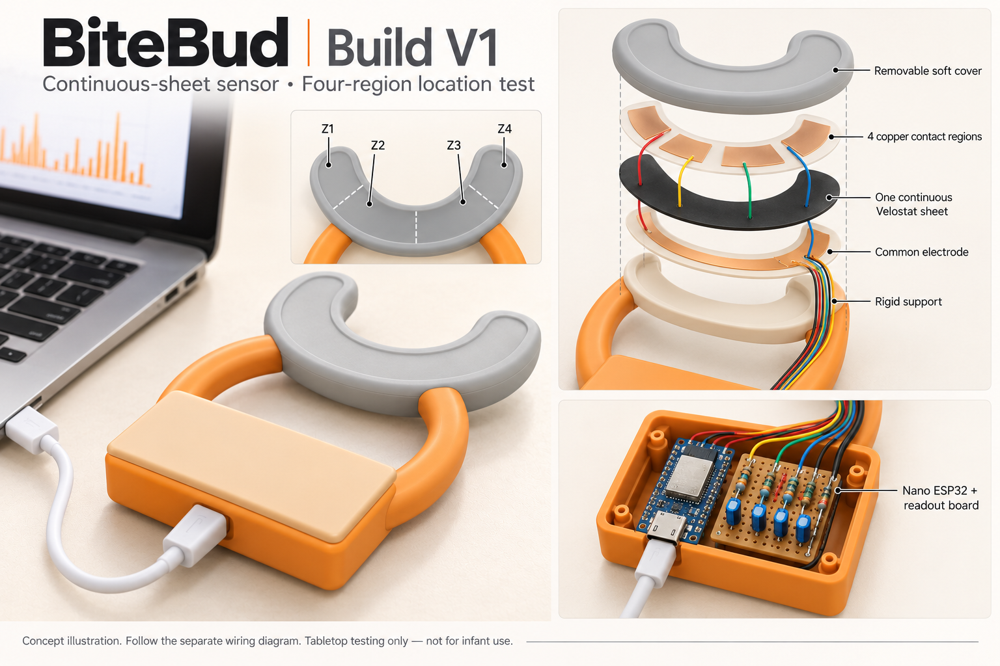
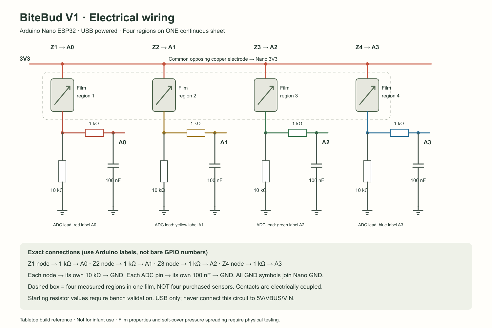

# BiteBud build V1: continuous-sheet, four-region tabletop prototype

Prepared October 29, 2026. Includes a concept image, deterministic schematic, physical layout template, firmware, Windows serial bridge, and local dashboard. The electronics/software design is specified; the Velostat assembly has not been physically built or validated here. Hand-pressed tabletop testing only, not infant or in-mouth use.

**GitHub publication scope:** the website, new dashboard, API implementation, and browser-test script remain local at the user's request. They are not included with this hardware/documentation commit. A fresh clone can upload the sketch and inspect USB readings, but cannot run `/prototype` or `/api/pressure-map` until that separate website work is included. Dashboard instructions below describe the local development copy. The screenshots show local software verification, not a deployed website update.



## What this build does

One continuous U-shaped Velostat film is read through four electrode regions: Z1 at the left tip, Z2 along the left/front curve, Z3 along the right/front curve, Z4 at the right tip, viewed from above with the handle toward you. These label device positions, not teeth or gums. Four channels connect directly to the existing Nano; this package does not implement eight or twelve.

Intended flow: hand press -> film resistance changes -> four ADC readings -> USB JSON -> Windows bridge -> local API -> highlighted region and completed contact count. Location accuracy, crosstalk, pressure spreading, and repeatability require physical testing.

## Package contents

- `concept.png`: AI-generated appearance illustration, not a pin-level electrical reference.
- `wiring.svg` / `wiring.png`: actual electrical reference.
- `cut-template.svg`: starting 1:1 insert and housing layout. Print at actual size and verify its 50 mm scale bar.
- `../../firmware/bitebud_pressure_map/bitebud_pressure_map.ino`: four-channel firmware.
- `../../scripts/pressure-map-bridge.ps1`: PowerShell 7 USB-to-server bridge.
- `../../src/pressure-map.jsx`: dashboard at `/prototype`.
- `VERIFICATION.md`: evidence and unverified boundaries.
- `IMAGE_PROMPT.txt`: prompt used with the built-in image-generation tool.

## Parts to obtain

Reuse your Nano ESP32, USB-C data cable, breadboard, laptop, and tools. No separate packaged force sensors, battery, external ADC, or multiplexer are required.

| Item | Quantity | Purpose |
| --- | ---: | --- |
| Velostat/Linqstat | 1 sheet | Cut ONE continuous U-shaped film |
| Thin copper foil with conductive adhesive | 1 sheet | Four upper contacts and one common opposing electrode |
| 10 kΩ resistors | 4 | Starting pulldowns, one per sensing node |
| 1 kΩ resistors | 4 | Series resistors between sensing nodes and ADC pins |
| 100 nF ceramic capacitors | 4 | One from each ADC pin to GND |
| Spare pulldown values | Optional | Four 1 kΩ and four 47 kΩ for divider experiments |
| Insulated wire, insulating film, tape | As needed | Five sensor leads, carriers, and insulated lead routing |
| Rigid support and box | 1 set | Reused material or school-printed body |
| Thin removable soft cover | 1 | Initial load-transfer experiment |
| Perfboard | Optional | Transfer the circuit after breadboard validation |

Budget: approximately $25–$50 for a flat coupon with reused supplies; around $50–$100 for a basic U-shaped model with inexpensive fabrication. This excludes tools, paid labor, custom molding, and infant-use testing. Reference listings: [Velostat $4.95](https://www.adafruit.com/product/1361), [foil $4.95](https://www.adafruit.com/product/4607). The film listing showed out of stock; check availability and delivered price before ordering.

## Assemble the sensor layers

Start with a small flat four-region coupon using the same electrical arrangement before cutting the full U.

From pressed surface downward:

1. Thin, removable soft cover.
2. Insulating carrier with FOUR separate copper contacts on its underside; bare copper faces the film.
3. ONE continuous Velostat sheet.
4. ONE common copper electrode on an insulating carrier; bare copper faces the film.
5. Rigid supporting backing.

Do not bridge the upper contacts. Inset copper edges inside the film outline so upper and lower foil cannot touch directly. Solder insulated leads to foil tabs before assembly and strain-relieve them. Insulate routing over the film so the leads do not become unintended sensing areas. Keep the stack replaceable.

The template uses an outer U radius of 50 mm, inner radius of 30 mm, and a 240-degree arc. The film is inset to radii 47/33 mm; contact regions use 45/35 mm radii with gaps. These are experimental dimensions, not approved teether dimensions. This planar insert does not sense every side of a three-dimensional cover.

The suggested housing is 86 × 61 mm outside, 80 × 55 mm inside, with approximately 20 mm internal height to explore. The Nano placeholder is approximately 45 × 18 mm, beside a 30 × 40 mm readout-board placeholder. Measure your actual board, headers, USB plug, and wiring before fabrication. This is a layout template, not a fabrication-verified CAD enclosure.

Inside the front housing: Nano, four pulldowns, four series resistors, four capacitors, shared ground wiring, and the sensor leads. Keep the USB connector accessible. Put the electronics in a separate box during initial tests if the housing does not yet fit.

## Actual wiring



Disconnect USB while wiring. Use the printed Arduino names A0–A3, not bare GPIO numbers or an assumed header orientation.

| Region | Node pulldown | Series connection | Capacitor |
| --- | --- | --- | --- |
| Z1, left tip | Z1 node -> 10 kΩ -> GND | Z1 node -> 1 kΩ -> A0 | A0 -> 100 nF -> GND |
| Z2, left/front | Z2 node -> 10 kΩ -> GND | Z2 node -> 1 kΩ -> A1 | A1 -> 100 nF -> GND |
| Z3, right/front | Z3 node -> 10 kΩ -> GND | Z3 node -> 1 kΩ -> A2 | A2 -> 100 nF -> GND |
| Z4, right tip | Z4 node -> 10 kΩ -> GND | Z4 node -> 1 kΩ -> A3 | A3 -> 100 nF -> GND |

**Common opposing electrode -> Nano 3V3. All GND connections -> Nano GND. USB powers the board. Do not connect the sensor circuit to 5V/VBUS/VIN.**

The pulldown is at the sensing node, before the series resistor. The capacitor is on the ADC side of the series resistor. Compression is intended to increase the reading. The four variable-resistance symbols represent regions of ONE film; the continuous material can conduct laterally and couple channels. Starting resistor values need experimental validation.

[Arduino documents A0–A3 as ADC1 inputs](https://docs.arduino.cc/tutorials/nano-esp32/cheat-sheet/). This sketch uses USB serial, without Wi-Fi credentials.

## Upload the firmware

1. In Arduino IDE, install **Arduino ESP32 Boards** and select **Arduino Nano ESP32**, not the classic AVR Nano or a generic ESP32 board.
2. Open `firmware/bitebud_pressure_map/bitebud_pressure_map.ino`.
3. Connect by USB data cable, choose the actual board port, and upload. Double-press reset if bootloader mode is needed; reselect the port if it changes.
4. Open Serial Monitor at 115200 baud. Expect approximately 20 JSON frames per second, such as `{"deviceId":"bitebud-map-v1","raw":[120,115,118,122]}`. These numbers are examples only.
5. Check that hand pressure changes readings. Close Serial Monitor before starting the bridge.

The sketch averages eight ADC conversions per region and discards a conversion after channel switching. It does not estimate force. See `VERIFICATION.md` for compilation evidence.

## Start the application

From the repository root in PowerShell 7:

```powershell
npm ci
npm run dev
```

Open [http://localhost:5173/prototype](http://localhost:5173/prototype). In a second terminal:

```powershell
[System.IO.Ports.SerialPort]::GetPortNames()
pwsh -File scripts/pressure-map-bridge.ps1 -Port COM5
```

Replace COM5 with the Nano's actual port. Keep Serial Monitor closed. The bridge forwards frames to `http://localhost:8787/api/pressure-map/frame`; no Wi-Fi setup is needed. Ctrl+C stops it and releases the port. Keep the default API/Vite ports for the simplest setup.

For a hardware-only checkout without the local dashboard/API changes, use Arduino Serial Monitor or run:

```powershell
pwsh -File scripts/pressure-map-bridge.ps1 -Port COM5 -SerialOnly
```

This prints frames without contacting any website or API.

The USB hardware and software simulation states are separate. Simulation is a software check, not evidence that the film works.

## Calibrate the actual sensor

1. Select **USB hardware** and confirm that all four ADC values update.
2. Leave the surface unloaded and steady for at least one second; click **Capture unloaded baseline**. This invalidates earlier reference captures.
3. Hold a repeatable moderate press at the center of Z1 with a rounded nonconductive tool for at least one second. Click **Capture Z1 reference** while holding, then release.
4. Repeat Z2–Z4, using comparable geometry and loading.
5. Press one region at a time. Similar large responses in several regions are labeled **Mixed / boundary contact**.

Displayed 0% is the unloaded reference; 100% is the captured press for that channel. Neither is a force unit. A hand press does not establish calibrated newtons or bite pressure. Hardware calibration persists in local ignored `data/pressure-map-calibration.json`; this dashboard's readings/session counts remain in memory.

A held contact spanning channels counts once, after release. Debounce is not a validated infant-chewing algorithm. Recalibrate after changes to film, cover, electrodes, backing, or resistors.

## Bench acceptance gate

Try ten randomized center presses per region. A possible team-set goal is at least 36 correct of 40, with repeatable release behavior. That is a proposed criterion, not achieved performance. Also test boundaries, two simultaneous contacts, long holds, and different loads. Repeat after installing the soft cover.

If regions are inseparable, revise electrode gaps, backing, cover thickness, and readout before continuing enclosure work. Cutting the film into islands would change the continuous-sheet requirement and is not assumed here.

| Symptom | Check |
| --- | --- |
| No port | Data cable, board selection, OS detection/driver, bootloader mode |
| Port busy | Close Serial Monitor/Plotter and other serial programs |
| Server unavailable | Keep `npm run dev` running; check `/api/health` |
| All near zero | Common foil to 3V3, wiring continuity, shorts to ground |
| Near 4095 | Electrode short, excessive preload, divider saturation; try smaller pulldowns such as 1 kΩ and recalibrate |
| Tiny change | Mechanical load transfer; try a larger pulldown such as 47 kΩ if not clipping |
| Noisy | Firm contacts, shared ground, strain relief, correct capacitors |
| All regions move together | Lateral conduction or mechanical spreading; redesign and retest |
| Capture rejected | Hold steady longer; need five fresh frames and reference at least 80 ADC counts above baseline |

No serial device was detected while preparing this package. No upload or physical sensor test has been performed. Successful compilation and software simulation do not establish usable location accuracy, infant safety, or oral suitability of these hobby materials.
